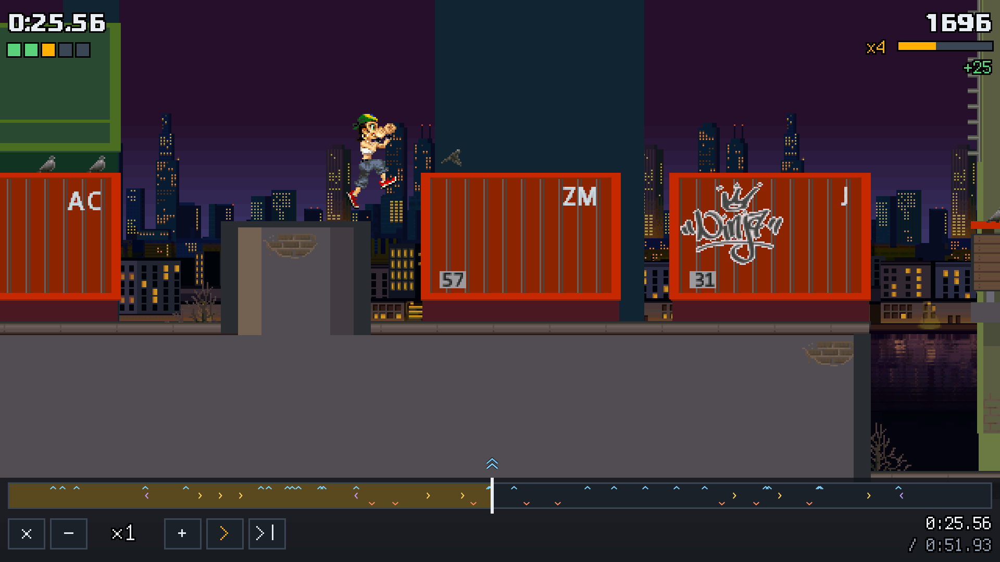

# Speedrunning Parapet Classic

Parapet Classic plays Playman Extreme Running (Mr. Goodliving, 2007) in a browser. The
simulation is a port of the original's own code: every step uses the same rules, the same
integer maths and the same data. The test suite compares it step by step against traces
recorded by running the original's own class files (`reference/oracle`). So a route found in
Parapet works on a phone, and the other way round. This page is for runners and for the moderators of
[speedrun.com/playman_extreme_running](https://www.speedrun.com/playman_extreme_running).

## How time works

- **The game runs in fixed steps.** Each step is 30 units of game time, a unit being one
  millisecond of the game clock. Every press is read on a step, so the result does not depend on
  the frame rate.
- **The game clock runs slower than real time.** Like the original, the game clock runs at
  900/1024 of real time: a minute of game time takes about 68 real seconds. A slow device does
  not skip frames; it plays in slow motion, as the original did.
- **The time on screen is in-game time (IGT).** The mission timer shows the game clock, in
  `m:ss.hh`. It is the time the records, the replays and the bosses count.

## Starting a fresh game

Options → **Reset all data** erases the records, the missions done and the bosses beaten. It
keeps the language, the controls, the player's name and the full-game timer's best. Every level
except the first is locked again, as on a first launch.

## The full-game timer

Turn it on in Options → **Full-game timer: shown**. It is hidden by default but counts all the
same.

- **What it counts.** It adds up the game clock of every attempt: finished, failed, restarted
  (R) or quit. It ticks only while a run is played. In the menus, briefings, the flyover,
  "get ready", pauses and results it stands still. So the total equals the sum of every attempt's
  mission time.
- **What survives.** The total is saved as the run goes, so a reload of the page keeps it.
- **Where it shows.** During a run it is at the top centre; in the menus, at the bottom right.
- **Splits.** A split is taken when a level's last mission is done. The gap to your best at the
  last split stands beside the total (to its right during a run).
- **The end.** The run stops with the last mission: the one that completes the last level
  still open while the timer runs. Nothing played after it counts. A timer zeroed halfway
  through a game never finishes. The credits show the final time and whether it is a new
  personal best.
- **Resetting.** Options → **Reset the timer** zeroes the run and the best. It is shown only
  while the timer is shown.

The board's 100 % and 101 % rules time real time from the first mission to the credits, menus
included, with a manual timer. That still works in Parapet. The built-in total is a different
measure (game time, menus excluded) and would need a category or a variable of its own.

## Replays: proof of a run

Every finished mission can be shared as a link (or a `.parapet-replay` file): Results → Copy
challenge link.

- **What a replay holds.** It holds the runner's presses, step by step, and nothing else: no
  claimed time.
- **How it is checked.** Opening a link re-runs the whole replay on the device. The card then
  shows the time and score that re-run produced, so a replay cannot claim a time its presses do
  not reach. A replay from another version of the simulation, or for other level data, is
  refused, not misread.
- **Watch or race.** A link opens a card with two choices:
  - **Watch the run** plays it back as the runner played it, with their character and name.
  - **Race it** runs the same mission against it as a ghost.
- **Studying a run.** Watching shows a bar along the bottom:

  

  - the whole run as a timeline with every press marked on it, and each press popping up as it
    plays;
  - a tap or a drag on the timeline goes to any moment;
  - `-` and `+` set the speed from ¼× to 4×, or ↑ and ↓ on the keyboard;
  - `||` pauses, or Space;
  - `>|` steps one frame forward, or →; ← steps one back.

- **Pressed keys for videos.** Options → **Show pressed keys** shows your own presses too: each
  one flies out to the left of the full-game timer as a chevron pointing its way (down from the
  top centre while the timer is hidden).

The version stands at the bottom of the results screen and in About → Credits (for example
`Parapet 1.2.0 · sim 0.2.0`: the game's release and the simulation's version). Put it in a
submission: a replay plays only on its own simulation version.

## Suggested rules for the remake

1. Keep the remake apart from the original's runs: a platform "Browser (Parapet Classic)" or a
   variable. The physics is the same, but input latency, the screen and the controls differ.
2. Single missions (Locations: Sprint, Flag Hunt, Score FLOW): the in-game time on the results
   screen, as now. The replay link is attached next to the video. A moderator opens it, watches
   it and sees the same time computed on their own device.
3. 100 % / 101 %: start with Reset all data. Either keep timing them in real time with a manual
   timer as the board does now, or add an in-game category timed by the full-game timer, which
   runs from the first mission to the last. A video that shows the timer on screen is enough
   to check it.
4. Note the version in the submission. Runs on different versions are comparable as long as
   the simulation version (`sim …`) is the same.

## Not in the original

These change nothing in how the game plays: no rule or number of the simulation is touched.

- **The camera** in Parapet does not look ahead of a jump upwards, and it follows the lower of
  the runner's feet and hands. The original aimed almost two tiles above a tiger jump on flat
  ground and then sank back for over a second after the landing (see
  `reference/notes/06-curiosities-and-bugs.md`). The camera never affects the run.
- **The boss contests** are added by Parapet: races against a boss's record on every level.
  They are not part of the original's progress, so 100 % does not include them.
