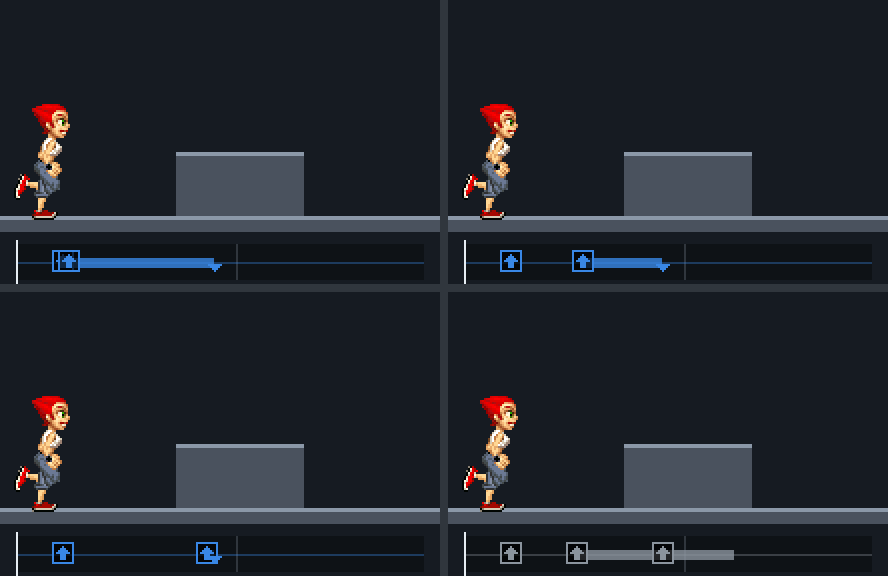
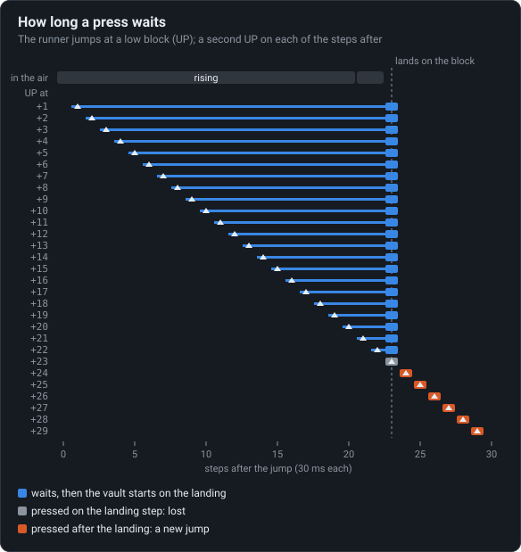

# Keys are pressed, never held

A press waits in a buffer until the runner can use it: a vault pressed anywhere in the jump
starts on the same step, and one more key on that step loses it.

<!-- findings:media vault -->

[The animation as an MP4, 60 frames a second](vault.mp4)
<!-- /findings -->

## What is going on

The game has no idea whether you are holding a key. Old phone keypads made that a sensible
choice: the game only hears the moment a key goes down. Holding UP for a second is one press,
not thirty.

A press the runner cannot use straight away is not thrown out either. The game keeps it in a
small memory of recent presses and lets it wait there while the runner carries on with what it
is doing. In the animation that waiting press is the arrow lit over the runner's head.

The monkey vault, a hop off the top of a low block, is started by such a waiting press. Jump
at the block, press UP once more, and the press just waits until the feet touch the top of
the block. Only then does the vault start. That is why the three runners above, who pressed
early, in the middle and just before landing, all vault on exactly the same moment: when you
pressed did not matter, only _that_ you pressed during the jump.

There is one catch, and it is shown in the fourth lane. The waiting press is only looked at on
a moment when no new key goes down. Press anything on the very moment of landing, even UP
again, and the game deals with the new press instead: no vault. The old press is still sitting
in its memory as the runner runs over the block, but nothing asks for it any more.

This is what makes the original feel rhythmic rather than twitchy: you announce a move a little
ahead, and the game plays it at the right time.

<!-- findings:media window -->

<!-- /findings -->

The chart tries the second UP on every moment of the jump, one run each. Pressed any time
during the 22 moments in the air, it waits (the thin line) and the vault always starts on the
landing (the square). Pressed on the landing itself, it is lost. Pressed after it, it is simply
a new jump.

**Try it** in [the Lab](https://gwynerva.github.io/parapet-classic/lab/#vault): move the second UP and press again on the landing.

The numbers

A "step" is one tick of the game's clock: 30 units of game time, about 34 ms.

<!-- findings:measured -->

| Measured                                                              |                                         |
| --------------------------------------------------------------------- | --------------------------------------- |
| Second UP that gives the vault                                        | 1 to 22 steps after the jump (22 steps) |
| Step every one of these vaults starts on                              | 23 steps after the jump                 |
| Step the runner lands on the block                                    | 23 steps after the jump                 |
| Keys that keep the vault when pressed on the landing step, UP waiting | none of UP, DOWN, FWD, BACK             |
| States that keep the buffer when entered (flag 0x40)                  | 13 of 135                               |

<!-- /findings -->

How it was measured

The level is the monkey vault demo of the Moves menu. The runner jumps at the block (UP on step
111), and a second UP is tried on every step from 1 to 29 steps after the jump, each in its own
run of the real simulation. The animation's lanes are four of those runs: UP at 1, 11 and 22
steps after the jump, and UP at 10 steps followed by another UP on the landing step. To check
that no key at all keeps the vault, each of UP, DOWN, FORWARD and BACK is pressed on the
landing step after a waiting UP.

Run it again with `npm run findings -- 1`. The experiment is
[`packages/lab/src/experiments/vault.ts`](../../../packages/lab/src/experiments/vault.ts), the
page's numbers and pictures
[`packages/lab/src/findings/01-keys-are-pressed-never-held.ts`](../../../packages/lab/src/findings/01-keys-are-pressed-never-held.ts).

Under the hood: the original’s code and Parapet’s

The memory of presses is the field `Q` of the runner. In
[`reference/decompiled/d.java`](../../decompiled/d.java) (CFR 0.152):

- line 7664, every step: `Q |= bB` adds the keys pressed this step (`bB`);
- lines 7779–7783, on entering a state of the move table: `Q` is kept only if the state has
  flag `0x40`, otherwise it is cleared. Thirteen of the 135 states keep it: the jump's rising
  state (18) clears it, the falling state (12) and running (2) keep it;
- lines 3668–3679 and `boolean_g` at line 9085: conditions 10–13 ("BACK, FORWARD, UP or DOWN
  waiting") test `Q`, and only when `bB == 0`, no key pressed this step;
- the air states end with "UP waiting, the feet land on an obstacle with room ahead → 62", the
  monkey vault ([`02-moves.md`](../../notes/02-moves.md), Moves → states).

Parapet keeps the same rules line for line: `inputBuffer` in
[`packages/sim/src/runner/step.ts`](../../../packages/sim/src/runner/step.ts),
`MoveFlag.KEEP_BUFFER` in
[`moves.ts`](../../../packages/sim/src/runner/moves.ts) and conditions 10–13 in
[`conditions.ts`](../../../packages/sim/src/runner/conditions.ts). Its touch buttons and the
keyboard deliver presses, never held keys, so a vault times the same as on a phone keypad.

