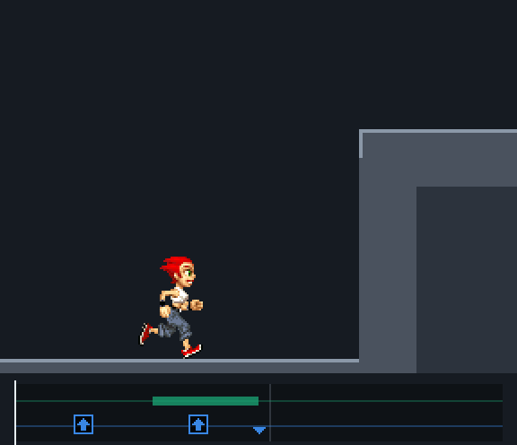
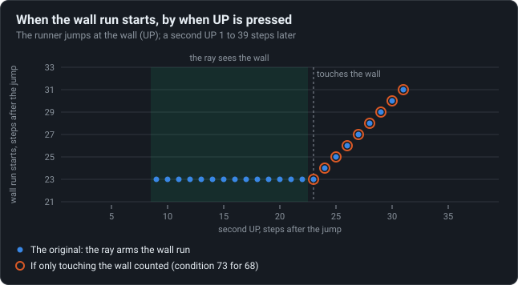

# Armed, not timed

In the air the runner looks ahead: UP pressed while it sees a wall arms the wall run, which
starts on contact, the same step for every press.

<!-- findings:media ray -->

[The animation as an MP4, 60 frames a second](ray.mp4)
<!-- /findings -->

## What is going on

Running up a wall looks like a matter of precise timing: press UP just as the feet touch it.
The original is kinder than that. While the runner is in the air it keeps feeling ahead with an
invisible line, the dashed line in the animation: from its feet to where its speed will carry it
in a moment, a little more than a tile away. When that line meets a wall tall enough to run
up, it turns green.

Press UP while the line is green and the runner does not do anything yet. It gets **ready**:
the wall run is armed (the "30" over its head). It then flies on exactly as before, and the
moment it touches the wall the wall run starts by itself (the "33").

<!-- findings:media armed -->

[The animation as an MP4, 60 frames a second](armed.mp4)
<!-- /findings -->

So it does not matter when you press within that window. The three runners on the left and at
the top right press early, midway and late while the line sees the wall, and all three start
running up the wall on the same step, the step they touch it. The fourth runner plays on a copy
of the game where only touching the wall counts, with the look-ahead taken out of the rules: the
very same press now does nothing at all, and the runner slides down.

<!-- findings:media start -->

<!-- /findings -->

The chart tries the second UP on every step after the jump. Wherever the look-ahead sees the
wall (green band) the wall run starts at the same moment, the contact: a flat line. After the
contact a press starts the wall run straight away: the diagonal. Without the look-ahead (rings)
only the diagonal is left, and the window for a wall run is less than half as long.

The original has several of these "armed" moves: the tic-tac and the wall flip off a wall, and
the pole tricks, are all prepared by a press while the look-ahead sees the thing, and done on
contact. It is why the game feels generous even on a small keypad.

**Try it** in [the Lab](https://gwynerva.github.io/parapet-classic/lab/#wallRun): move the second UP and switch the look-ahead off.

The numbers

A "step" is one tick of the game's clock, about 34 ms; a tile is 1024 units of the world.

<!-- findings:measured -->

| Measured                                                      |                                                  |
| ------------------------------------------------------------- | ------------------------------------------------ |
| The ray sees the wall                                         | 9 to 22 steps after the jump                     |
| Second UP that arms the wall run (state 30)                   | 9 to 22 steps after the jump                     |
| Step every armed wall run starts on                           | 23 steps after the jump                          |
| Step the runner touches the wall                              | 23 steps after the jump                          |
| Armed before the jump tucks its legs: meets the wall lower by | 160 units (presses 9 to 10 steps after the jump) |
| Reach of the ray at the jump’s speed                          | 1417 units (1.38 tiles)                          |
| Presses (of 39) that give a wall run                          | 23                                               |
| The same if only touching the wall counted                    | 9                                                |

<!-- /findings -->

How it was measured

The level is the wall run demo of the Moves menu: the runner jumps at a wall (UP on step 121),
and a second UP is tried on every step from 1 to 39 steps after the jump. After every step the
look-ahead is cast again on a **copy** of the runner, so watching it changes nothing, and
condition 68 ("the look-ahead sees a wall that goes on up") is evaluated on that copy. The
counterfactual "only touching counts" is the same run on a copy of the move table where the air
states arm the wall run on condition 73 (touching a wall) instead of 68; the game's code is not
touched.

Run it again with `npm run findings -- 2`. The experiment:
[`packages/lab/src/experiments/wallRun.ts`](../../../packages/lab/src/experiments/wallRun.ts)
and [`lookahead.ts`](../../../packages/lab/src/experiments/lookahead.ts); the page:
[`packages/lab/src/findings/02-armed-not-timed.ts`](../../../packages/lab/src/findings/02-armed-not-timed.ts).

Under the hood: the original’s code and Parapet’s

In [`reference/decompiled/d.java`](../../decompiled/d.java) (CFR 0.152):

- `boolean_a(e, int, int)`, line 9069: the look-ahead ray, from the feet (the hands when they
  hold on) along the velocity, `vx · 400 / 1024` across and `vy · 400 / 1024` down: where the
  runner will be in 400 time units;
- condition 68, line 4029: the ray hits a wall or a ledge and the tile above the hit is a wall
  too; or the runner already touches one;
- the air states' list: "UP and 68 and … → 30" arms the wall run; state 30 has no time limit
  and goes to 33, the wall run, on contact ([`02-moves.md`](../../notes/02-moves.md), Wall run).

A detail the sweep turned up: the jump's own state lifts the feet by 160 units halfway through
(its legs tuck; snap type 12 in the move table). A press in the first two steps of the window
arms the wall run before that, so this runner meets the wall 160 units (5 pixels) lower; it
still starts on the same step.

Parapet runs the same ray and the same conditions:
`lookaheadRay` and case 68 in
[`packages/sim/src/runner/conditions.ts`](../../../packages/sim/src/runner/conditions.ts).

