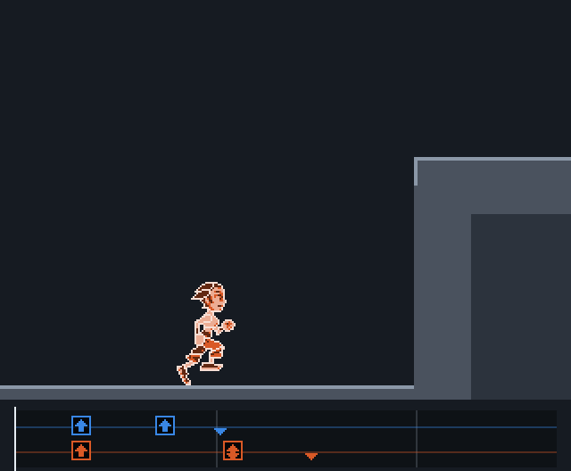
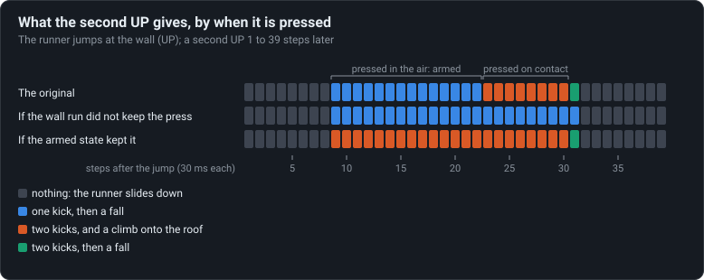

# One press, two kicks

Pressed on contact, one UP kicks off the wall twice and climbs; pressed a moment earlier, once,
and falls.

<!-- findings:media kicks -->

[The animation as an MP4, 60 frames a second](kicks.mp4)
<!-- /findings -->

## What is going on

A wall run is a series of kicks off the wall, each one pushing the runner up. Every kick needs
an UP, so two kicks need two presses... except that they don't, sometimes.

The two runners above do the same thing: jump at the wall, then press UP once more. The blue
one presses a little early, while still in the air (it is "armed", see
[Armed, not timed](../02-armed-not-timed/)); the orange one presses as it touches the wall. The
blue runner kicks once and falls back. The orange one kicks **twice**, reaches the top and
climbs onto the roof.

The difference is the little memory of presses from
[Keys are pressed, never held](../01-keys-are-pressed-never-held/). When the wall run starts
from a press on contact, that same press stays in the memory, and the second kick asks for "an
UP pressed or waiting": it finds the old one and goes. When the wall run starts from the armed
state, the armed state has already wiped the memory, so the press is spent on arming and the
second kick finds nothing.

So the press that looks "late" is worth two kicks, and the one that looks well prepared is
worth one. A player who learns the wall run on the original learns, without knowing why, to
press on contact.

<!-- findings:media sweep -->

<!-- /findings -->

The chart tries the second UP on every step after the jump. In the original (top row) presses
in the air give one kick, presses on contact give two and a climb. The two rows under it play
the same presses on copies of the game with one rule changed. If the wall run did not keep the
press, no press would ever give two kicks. If the armed state kept it, the early presses would
climb too. Which shows the double kick comes from that one rule, and the difference between the
two kinds of press from the other.

**Try it** in [the Lab](https://gwynerva.github.io/parapet-classic/lab/#wallRun): switch the two rules about the press off and on.

The numbers

A "step" is one tick of the game's clock, about 34 ms. The vertical speeds are in world units
(1024 to a tile) per 1024 units of time; negative is up.

<!-- findings:measured -->

| Measured                                                    |                               |
| ----------------------------------------------------------- | ----------------------------- |
| Second UP arming the wall run in the air: one kick, a fall  | 9 to 22 steps after the jump  |
| Second UP on contact: two kicks, a climb onto the roof      | 23 to 30 steps after the jump |
| Step every armed wall run starts on                         | 23 steps after the jump       |
| Vertical speed of the two kicks (units per 1024 time units) | -4123, -3293                  |
| Most kicks if the wall run (33) cleared the buffer          | 1                             |
| Kicks of an armed wall run if 30 kept the buffer            | 2, and it climbs              |

<!-- /findings -->

How it was measured

The wall run demo of the Moves menu: the runner jumps at the wall (UP on step 121) and a second
UP is tried on every step from 1 to 39 steps after the jump, each in its own run of the real
simulation. A kick is an entry into one of the wall run's states (33, 36, 37); a climb is a grab
of the roof's edge. The "what if" rows run the same presses on copies of the move table with
flag `0x40` (keep the presses) taken off state 33, or put on state 30; the game's code is not
touched. The animation compares the press 14 steps after the jump with the one 25 steps after.

Run it again with `npm run findings -- 3`. The experiment:
[`packages/lab/src/experiments/wallRun.ts`](../../../packages/lab/src/experiments/wallRun.ts);
the page:
[`packages/lab/src/findings/03-one-press-two-kicks.ts`](../../../packages/lab/src/findings/03-one-press-two-kicks.ts).

Under the hood: the original’s code and Parapet’s

- The wall run: UP while touching a wall (condition 73) enters state 33; UP while the
  look-ahead sees one (68) enters state 30, which enters 33 on contact. Each kick lasts 600 time
  units; 33 goes on to 36 and 37 on UP, pressed or waiting, while the kick is young
  ([`02-moves.md`](../../notes/02-moves.md), Wall run).
- State 33 has flags `0x540`: `0x40` keeps the memory of presses when it is entered
  ([`d.java`](../../decompiled/d.java) lines 7779–7783). State 30 has no flags at all, so
  entering it clears the memory, and entering 33 from 30 keeps an empty one.
- See the whole record of state 33 on the page
  [The parkour is a table](../04-the-parkour-is-a-table/).

Parapet keeps the move table as the original ships it, so the double kick, and the single one,
are there exactly; [`packages/sim/src/runner/step.ts`](../../../packages/sim/src/runner/step.ts)
applies the flag on entry like the original.

