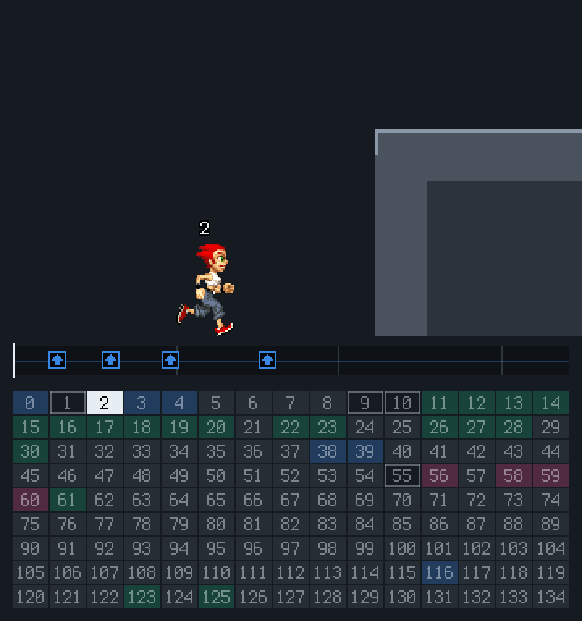
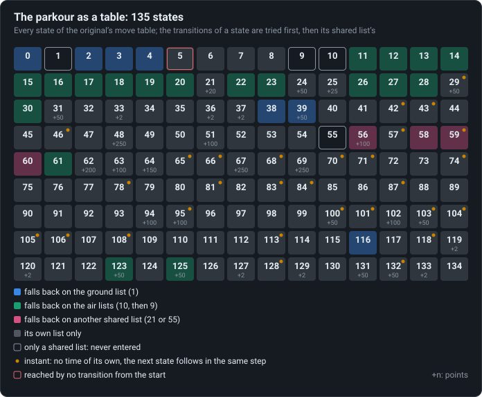

# The parkour is a table

Every move is a few rows of one table of 135 states; the code only runs it. Read whole, the
table has instant states, a state only the code enters and transitions that never fire.

<!-- findings:media trace -->

[The animation as an MP4, 60 frames a second](trace.mp4)
<!-- /findings -->

## What is going on

You might expect each move of a parkour game to be a piece of program: "if the player presses
UP near a wall, do the wall run". In Playman Extreme Running almost none of that is code. The
moves are **data**: a table of 135 states, each one a moment of a move (running, the take-off
of a jump, the first kick of a wall run, a stumble...), and for each state a short list of
rules of the kind "if these conditions hold, go to that state". The code is a small engine
that reads the table: about eighty yes-or-no questions (is the runner on the ground? is a wall
ahead? was UP pressed?), some twenty ways to push the runner, and the step that ties them
together.

The animation shows the engine at work. The runner jumps at a wall, runs up it, grabs the
roof's edge and climbs over; under it, the whole table, with the state the runner is in lit
and the ones it just left outlined. Look at the grab: two cells light up at once. Some states
take no time at all; the engine goes straight on to the next one within the same tick.

<!-- findings:media table -->

<!-- /findings -->

Laid out like a periodic table, the 135 states fall into families by the shared list of rules
they fall back on: everything on the ground shares the ground's list, everything in the air
the air's. Read as a whole, the table also shows things no player would ever notice:

- four states are only shared lists: nothing ever enters them;
- one state, the stop, is never reached by any rule: only the code sends a rival there when its
  recording runs out (see [Rivals are replays](../11-rivals-are-replays/));
- two rules can never fire, because an earlier rule of the same list asks for less and always
  wins;
- 29 states are "instant", like the ones at the grab.

<!-- findings:media record -->

<!-- /findings -->

And this is one state as the original stores it: fourteen numbers, then its list of rules.
Each rule is one number holding up to four questions, one per byte, and the state to go to.
The wall run's flags hold the detail behind [One press, two kicks](../03-one-press-two-kicks/).

The numbers

<!-- findings:measured -->

| Measured                                                    |                                             |
| ----------------------------------------------------------- | ------------------------------------------- |
| States, and numbers per state                               | 135 × 14 = 1890 ints                        |
| Transitions, in transition lists                            | 212 in 52 lists                             |
| Conditions, impulse types, snap types used                  | 80, 22, 29                                  |
| States that are only a shared list (never entered)          | 1, 9, 10, 55                                |
| States the table enters but the start never reaches         | 5                                           |
| Instant states (no time, the next follows in the same step) | 29                                          |
| Transitions that can never fire                             | 1: 25→100 behind 25→99; 5: 78→5 behind 78→2 |
| States that score points                                    | 31                                          |

<!-- /findings -->

How it was measured

Everything is read from the original's table as extracted (`moves.json`): what enters each
state, what can be reached from the two starting states (0 and 2) through rules and timers,
which rule is beaten by an earlier one of the same list whose conditions are a subset of its
own, and which states have no duration but a next state. The animation is the Moves menu's wall
run demo with its own presses.

Run it again with `npm run findings -- 4`. The analysis:
[`packages/lab/src/experiments/table.ts`](../../../packages/lab/src/experiments/table.ts); the
pictures: [`tableArt.ts`](../../../packages/lab/src/experiments/tableArt.ts); the page:
[`packages/lab/src/findings/04-the-parkour-is-a-table.ts`](../../../packages/lab/src/findings/04-the-parkour-is-a-table.ts).

Under the hood: the original’s code and Parapet’s

- The table is `var_int_arr_I`, 2366 ints of blob 16: 135 records of 14 ints, then the
  transition lists ([`02-moves.md`](../../notes/02-moves.md) has every field and flag).
- `boolean_h`, [`d.java`](../../decompiled/d.java) line 9321: a state's list, then its parent's,
  first match wins; `O(int)`, line 9239: entering a state (flags, the memory of presses, snap,
  push). The conditions are `boolean_d(int)`, line 3612.
- The two rules that never fire: in the ground list (state 1), "hands on a ledge corner → 100"
  comes after "hands on a ledge corner → 99"; in state 5, "78 → 5" after "78 → 2".
- Instant states: a state of duration 0 with a next state is left on the same step; the step
  loops while that holds.

Parapet's engine is the same table and the same loop:
[`packages/sim/src/runner/moves.ts`](../../../packages/sim/src/runner/moves.ts) holds the table,
`updateTransitions` and the step loop are in
[`step.ts`](../../../packages/sim/src/runner/step.ts), the conditions in
[`conditions.ts`](../../../packages/sim/src/runner/conditions.ts). Its runs match the original's
step for step (the oracle traces of [`07-oracle.md`](../../notes/07-oracle.md)).

