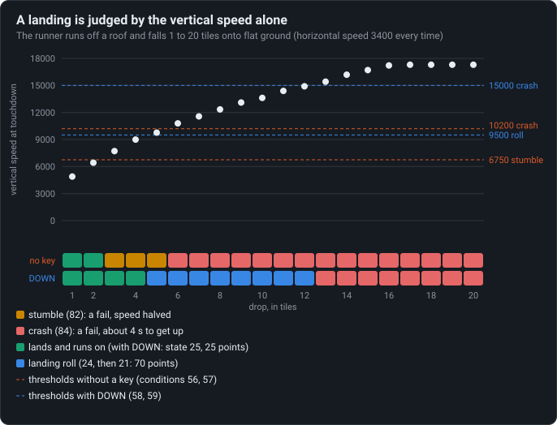

# Landing keeps the horizontal speed

At touchdown the fall’s speed is thrown away and the horizontal speed kept; how hard the
landing is depends on the vertical speed alone.

<!-- findings:media landing -->

[The animation as an MP4, 60 frames a second](landing.mp4)
<!-- /findings -->

## What is going on

Two runners run off the same roof, four tiles up. The arrows are their speed: blue across,
orange down. As they fall the orange arrow grows; the blue one stays as it was.

At touchdown the orange arrow simply disappears. Whatever speed the fall built up is not turned
into running, not bounced, just dropped: the runner carries on with the horizontal speed it had
when it left the roof. That is the whole landing physics of the original.

How the landing goes is decided by that vertical speed alone, the length of the orange arrow
just before touchdown, against four thresholds. The left runner pressed nothing: from four tiles
it lands too hard, stumbles, and loses half of its horizontal speed. The right runner pressed
DOWN in the air, which prepares the landing and moves the thresholds up: the same fall is now a
soft landing, worth points, and the speed is kept.

<!-- findings:media grades -->

<!-- /findings -->

The chart drops the runner from every height from 1 to 20 tiles. The vertical speed at
touchdown grows with the height until it hits the game's speed limit for falling, and the
dashed lines are the thresholds. Without a key, a drop of up to two tiles is fine, three to five
stumble and six or more crash. With DOWN, up to four tiles land softly, five to twelve end in a
roll and only thirteen or more crash.

Since only the vertical speed counts, running faster never makes a landing harder, and a long
jump lands as safely as a short one from the same height.

**Try it** in [the Lab](https://gwynerva.github.io/parapet-classic/lab/#landing): drop the runner from any height, with DOWN or without.

The numbers

Speeds are in world units (1024 to a tile) per 1024 units of time.

<!-- findings:measured -->

| Measured                                                        |                           |
| --------------------------------------------------------------- | ------------------------- |
| Without a key: lands running, stumbles, crashes (drop in tiles) | 1 to 2; 3 to 5; 6 to 20   |
| With DOWN: soft landing, roll, crash                            | 1 to 4; 5 to 12; 13 to 20 |
| Horizontal speed before and after a clean landing               | 3400 → 3400               |
| Vertical speed before and after                                 | 4883 → 0                  |
| Horizontal speed after a stumble, after a crash                 | 1725, 257                 |
| Fastest fall (reached from a drop of)                           | 17300 (17 tiles)          |

<!-- /findings -->

How it was measured

A generated level for every height from 1 to 20 tiles: a roof, a wall down to flat ground. The
runner runs off the edge on its own; for the DOWN runs DOWN is pressed two steps after it
starts to fall. The landing is the first state of a landing after the fall: running on (2), soft
landing (25), roll (24), stumble (82), crash (84). The animation compares the four-tile drop
without a key and with DOWN.

Run it again with `npm run findings -- 5`. The experiment:
[`packages/lab/src/experiments/landing.ts`](../../../packages/lab/src/experiments/landing.ts);
the page:
[`packages/lab/src/findings/05-landing-keeps-horizontal-speed.ts`](../../../packages/lab/src/findings/05-landing-keeps-horizontal-speed.ts).

Under the hood: the original’s code and Parapet’s

- Touching a floor or a slope, [`d.java`](../../decompiled/d.java) line 7723: the new velocity
  is the old horizontal speed `t` along the surface, `q = t · (−f) / 1024`, `r = t · e / 1024`
  (`(e, f)` the surface's normal). On flat ground that is "keep `q`, drop `r`"; on a slope the
  horizontal speed is turned along it, and the fall is still lost.
- The grades are conditions 56–59 (lines 3945 on), all on `|v|`, the vertical speed before the
  step: over 6750 a stumble and over 10200 a crash without DOWN; over 9500 a roll and over 15000
  a crash after DOWN ([`02-moves.md`](../../notes/02-moves.md), Landing).
- The fall is capped at 17300 ([`03-physics.md`](../../notes/03-physics.md)).

Parapet: the contact response in
[`packages/sim/src/runner/step.ts`](../../../packages/sim/src/runner/step.ts), the conditions
in [`conditions.ts`](../../../packages/sim/src/runner/conditions.ts); unchanged.

