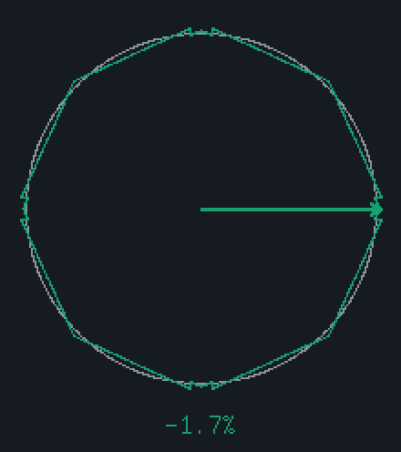
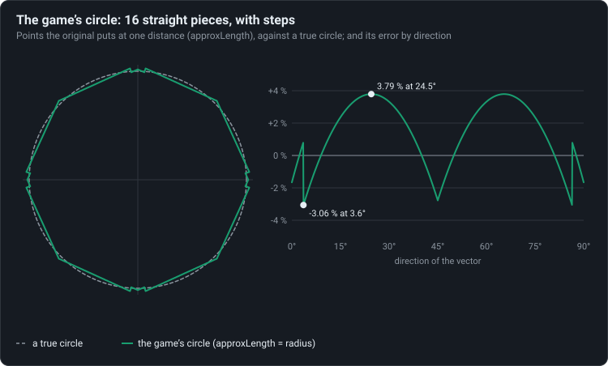
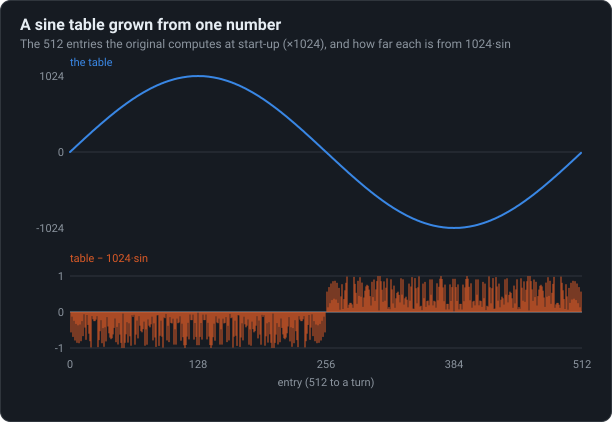

# Fixed-point maths

No floating point anywhere: lengths come from a 16-sided “circle” with steps in it, the sine
table is grown from one number, square roots are exact integers.

<!-- findings:media circle -->

[The animation as an MP4, 60 frames a second](circle.mp4)
<!-- /findings -->

## What is going on

The phones the game was made for (Java ME, 2007) could not count with fractions. Everything in
the original is a whole number: positions in 1024ths of a tile, time in milliseconds, speeds in
1024ths of a tile per second or so. Three bits of maths show how it gets by.

**Length.** Measuring how fast the runner goes means a square root, which is slow on such a
phone. The original estimates it instead, with a formula that only adds and multiplies: a
little of the smaller part of the speed plus most of the larger. Draw every point it puts "one
length" away and you do not get a circle but a shape of 16 straight pieces, the green line in
the animation. Turning the arrow shows how far off the estimate is in each direction: up to
3.8 % too long, up to 3 % too short. Near each axis the shape even has a little step: where a
correction kicks in, a speed just one way of it is measured almost 4 % longer than one just the
other way.

<!-- findings:media norm -->

<!-- /findings -->

**Sines.** Swings of some moves, the water's waves and the warm-up arrows' pulse need sines. The
original does not store a table of them, it grows one when the game starts: from a single
number (the cosine of one 512th of a turn) a short recurrence produces all 512 entries. The
chart shows the table against the true sine: no entry is off by as much as 1 in 1024.

<!-- findings:media sine -->

<!-- /findings -->

**Square roots.** Where the exact speed matters (the hard speed limit on the ground, some jumps) the game
does take a square root, bit by bit, in whole numbers. It is exact for every number it can
meet: the check below tried more than sixteen million of them.

**Try it** in [the Lab](https://gwynerva.github.io/parapet-classic/lab/#circle): watch the vector turn.

The numbers

<!-- findings:measured -->

| Measured                                  |                                                      |
| ----------------------------------------- | ---------------------------------------------------- |
| approxLength against the true length      | -3.06 % (at 3.58°) to +3.79 % (at 24.50°)            |
| Straight pieces of the game’s circle      | 16                                                   |
| Step in the measured length               | +3.89 % of the length, 3.58° off each axis           |
| Sine table entries, largest error (×1024) | 512, 0.997                                           |
| Entries equal to 1024·sin rounded         | 268 of 512                                           |
| isqrt exact for every n below             | 2^30 (16,863,232 values checked); 32767 from 2^30 on |

<!-- /findings -->

How it was measured

The game's own functions are called on test values: `approxLength` on vectors of length 2²⁰ in
every direction, a hundredth of a degree apart (long vectors, so the rounding does not show);
the sine table built by `buildSineTable` against `1024 · sin`; `isqrt` on every number below
2²⁴ and on every square up to 2³⁰ with its two neighbours.

Run it again with `npm run findings -- 6`. The experiment:
[`packages/lab/src/experiments/fixedPoint.ts`](../../../packages/lab/src/experiments/fixedPoint.ts);
the page:
[`packages/lab/src/findings/06-fixed-point-maths.ts`](../../../packages/lab/src/findings/06-fixed-point-maths.ts).

Under the hood: the original’s code and Parapet’s

In [`d.java`](../../decompiled/d.java):

- `int_f`, line 9116, the length: `(441 · small + 1007 · big) >> 10`, less `40 · big` when the
  larger part is under 16 times the smaller (the step, at atan(1/16) ≈ 3.58° off an axis);
- `short_arr_a`, line 3447, the sine table: `cos((n+1)θ) = 2 cos θ · cos(nθ) − cos((n−1)θ)` in
  30-bit fixed point from `1073660973` ≈ cos(2π/512) · 2³⁰, kept as 10-bit values; the game
  builds it started at entry 128, which makes it a sine table;
- `int_o`, line 9139, the square root, bit by bit from 2²⁸: exact below 2³⁰, and 32767 from
  there on (speeds never come near it).

Parapet uses the same functions, in
[`packages/sim/src/math/int.ts`](../../../packages/sim/src/math/int.ts), wherever the
simulation does; the screen may use real numbers for drawing.

