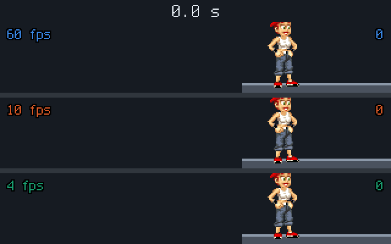
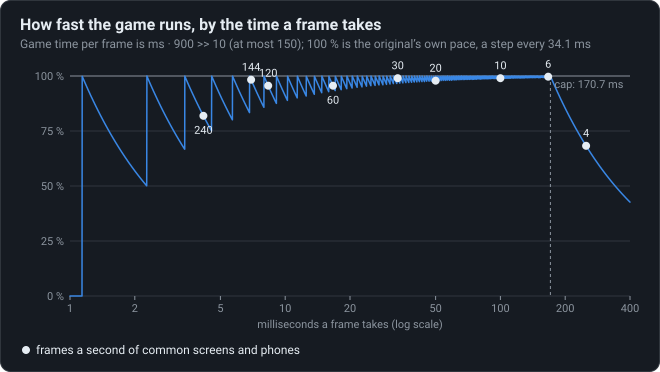

# Slow phones slow down

Game time per frame is capped, so a slow phone plays in slow motion rather than skipping; and it
is cut to whole units, so every screen runs a little slow, a fast one more.

<!-- findings:media race -->

[The animation as an MP4, 60 frames a second](race.mp4)
<!-- /findings -->

## What is going on

A game has to decide what to do when the device cannot keep up. Many games skip ahead: on a
slow phone the runner jumps further between pictures but arrives on time. The original does
something else.

Each time it draws a picture, it measures how long the last one took and moves the game on by
that much (times 900/1024, so a tick of the game is about 34 ms of real time). But never by more
than 150 units of game time at once. On a phone that draws fewer than about six pictures a
second, the game simply runs slower than real time. In the animation, all three lanes show the
same run for six seconds of real time. At 10 pictures a second the runner jumps from picture to
picture but keeps up; at 4 the game has done fewer ticks and the runner falls behind, in slow
motion.

There is a second, sneakier effect. The time added for each picture is cut to a whole number of
units. The fraction lost is small, but it is lost on every picture, so the more pictures a
second, the more is lost. At 60 pictures a second each frame adds 14 units where 14.65 are due:
the game runs at 95.6 % of its own pace, and the first lane, at 60, is a few ticks behind the
one at 10. At 240 it would run at 82 %, and above about 875 pictures a second it would not move
at all.

<!-- findings:media pace -->

<!-- /findings -->

The chart is the pace of the game against the time one picture takes, from the original's
formula: the saw-teeth come from the cut to whole units, and the fall on the right from the cap.
Parapet keeps the cap but carries the fraction over, so it runs at 100 % on any screen.

**Try it** in [the Lab](https://gwynerva.github.io/parapet-classic/lab/#pace): try any phone’s frame rate.

The numbers

<!-- findings:measured -->

| Measured                                                              |                                 |
| --------------------------------------------------------------------- | ------------------------------- |
| A step of 30 units lasts                                              | 34.13 ms (29.3 a second)        |
| Units a frame adds at 60 frames a second                              | 14 (pace 95.6 %)                |
| Pace at 144 and at 240 frames a second                                | 98.3 %, 81.9 %                  |
| Frames longer than this add only 150 units                            | 170.67 ms                       |
| A phone at 4 frames a second                                          | 150 units a frame (pace 68.3 %) |
| Steps in 10 s at 4 frames a second, at the own pace                   | 200, 292                        |
| Frames shorter than this add nothing                                  | 1.14 ms                         |
| Steps in 10 s at 60 and at 240 frames a second: the original, Parapet | 280 and 240; 292 and 292        |

<!-- /findings -->

How it was measured

Parapet's port of the frame loop, `FixedStepClock`, is fed frames of a constant length and
counts the ticks it runs; the pace is the time units added against `ms · 900 / 1024`. The
animation records one run on a flat level and shows, for each frame rate, the tick its clock has
reached at each moment of real time, updated only when a frame of that rate is due.

Run it again with `npm run findings -- 7`. The experiment:
[`packages/lab/src/experiments/pace.ts`](../../../packages/lab/src/experiments/pace.ts); the
page:
[`packages/lab/src/findings/07-slow-phones-slow-down.ts`](../../../packages/lab/src/findings/07-slow-phones-slow-down.ts).

Under the hood: the original’s code and Parapet’s

- [`d.java`](../../decompiled/d.java) line 10477: `ch = w * 900 >> 10` with `w` the frame's
  milliseconds, capped at 150; a tick runs per 30 units of `ch` collected
  ([`03-physics.md`](../../notes/03-physics.md)).
- The 150 units are 170.67 ms of real time: below 5.86 pictures a second the cap holds.

Parapet keeps the cap but not the loss
([`packages/runtime/src/app/GameLoop.ts`](../../../packages/runtime/src/app/GameLoop.ts)): the
fraction a frame leaves is carried to the next (`FrameUnits`), so the game runs at the original's
own pace on any screen, as it did on the phones of 2007, whose 15 to 25 frames a second lost only
1 or 2 %. Up to version 1.0.0 it fed the browser's frame times into the original's formula and
ran at 95.6 % of that pace on a 60 Hz screen and at 82 % on a 240 Hz one. The pace never changed
the runs themselves: records, replays and the bosses' times count steps of the game, not real
time.

