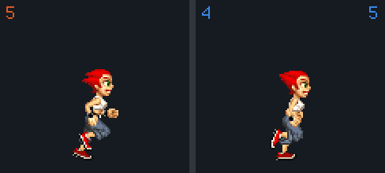
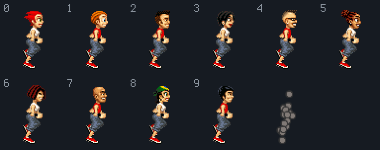
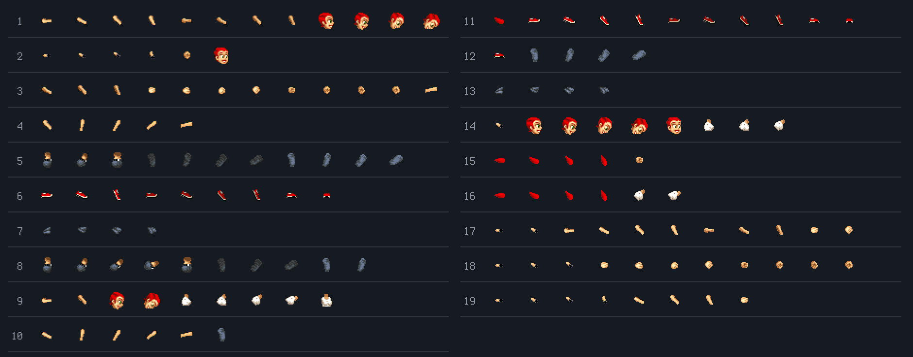

# One vector runner

The runner is no sprite sheet: 19 layers of small sprites placed anew in each of 463 keyframes
and tweened between them; a character is a swap of a few sprites.

<!-- findings:media parts -->

[The animation as an MP4, 60 frames a second](parts.mp4)
<!-- /findings -->

## What is going on

Most games of the time drew their heroes as a strip of complete pictures, one per pose. The
original's runner is a puppet. It is made of small pieces (a head, a ponytail, a torso, upper
and lower arms and legs, hands, shoes) and every pose says where each piece goes and how it is
turned. Pull the pieces apart, as in the animation, and the runner is plainly a set of separate
sprites moving together.

The poses are 463 keyframes, and the game never shows one as it is: each picture is a blend
from the previous keyframe to the current one. Slowed down four times, the difference shows:

<!-- findings:media tween -->

[The animation as an MP4, 60 frames a second](tween.mp4)
<!-- /findings -->

On the left, the keyframes alone, snapping from pose to pose; on the right, the runner as the
game draws it.

Because the runner is a puppet, the other nine characters cost almost nothing: each is the
same puppet with another head, and for the men another torso and arms, and without Blaise's
ponytail. Even the "ghost" of an earlier player in the original's pass-the-phone multiplayer is
the same puppet, with every piece replaced by a grey dot.

<!-- findings:media skins -->

[The animation as an MP4, 60 frames a second](skins.mp4)
<!-- /findings -->

The pieces are not fixed body parts, though. The puppet has 19 layers, drawn back to front,
and a keyframe can put any sprite in any layer: the same layer holds a forearm in one pose and
the head in another. That is how an arm swings behind the body and then in front of it. Below,
each layer's sprites over all 463 keyframes, a row per layer:

<!-- findings:media wardrobe -->

<!-- /findings -->

**Try it** in [the Lab](https://gwynerva.github.io/parapet-classic/lab/#runner): pull the pieces apart, change the character, turn the blending off.

The numbers

<!-- findings:measured -->

| Measured                           |                     |
| ---------------------------------- | ------------------- |
| Keyframes of the runner            | 463                 |
| Layers, and the sprites they show  | 19, 65              |
| Its box, and the pivot on the feet | 134 × 142, (50, 76) |
| Animation clips                    | 68                  |
| Keyframes no clip uses             | 67                  |

<!-- /findings -->

How it was measured

The runner is the first object of the scene file `k0`, read by Parapet's scene renderer; the
pictures are drawn with the game's own sprites and the same placing, swapping and tweening
code as the game. The run cycle comes from a run of the real simulation on a flat level. A
keyframe counts as used when some animation clip lists it.

Run it again with `npm run findings -- 8`. The experiment:
[`packages/lab/src/experiments/vectorRunner.ts`](../../../packages/lab/src/experiments/vectorRunner.ts);
the page:
[`packages/lab/src/findings/08-one-vector-runner.ts`](../../../packages/lab/src/findings/08-one-vector-runner.ts).

Under the hood: the original’s code and Parapet’s

- The runner: `k0` object 0, 463 frames, pivot (50, 76), 134 × 142 pixels, 19 primitives of
  type "sprite" whose position, sprite and transform change per frame
  ([`04-rendering.md`](../../notes/04-rendering.md), Character animation).
- `aj`, [`d.java`](../../decompiled/d.java) line 5886: every picture tweens from the previous
  keyframe to the current one; `b(8 ints)`, line 3218, places the pieces.
- Skins, `a(int, int[])`, line 5931: character `c` takes heads `82 + 5(c − 1) … + 4` for 25–29,
  the men (1, 2, 4, 7, 9) torso and arm sprites 127–136 for 34–38 and 57–61, and every character
  but Blaise hides 13–16, the ponytail.
- The hot-seat ghost, line 3348: every swappable piece becomes sprite 80, an 8 × 8 dot, the
  ponytail hidden.

Parapet draws the same puppet ([`Pose.ts`](../../../packages/runtime/src/render/Pose.ts),
[`SceneRenderer.ts`](../../../packages/runtime/src/render/SceneRenderer.ts),
`skinSwap` in [`Rig.ts`](../../../packages/runtime/src/render/Rig.ts)), and blends between
ticks too on fast screens. Its ghosts and rivals are not dots but see-through holograms of the
same puppet ([`EchoRenderer.ts`](../../../packages/runtime/src/render/EchoRenderer.ts)).

