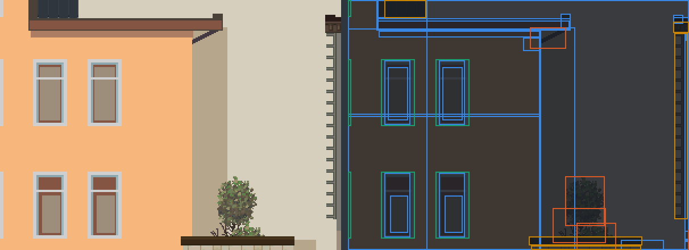
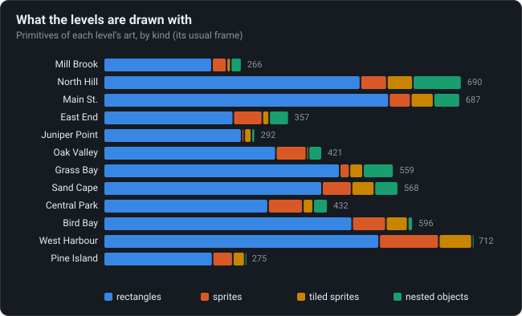
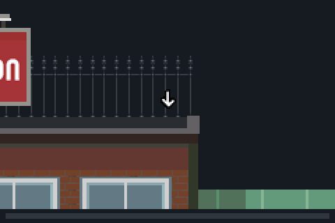

# Vector backgrounds

The levels are not pictures: each is one object of coloured rectangles, sprites and shared props,
drawn anew every frame, and the warm-up’s arrows pulse by tweening it.

<!-- findings:media xray -->

<!-- /findings -->

## What is going on

A level of the original is about 3000 pixels wide, a dozen screens of buildings, fences, trees and
posters. Even squeezed into today's compressed pictures, the twelve levels would take several
times the whole game, which is 265 KB. So the levels are not pictures but drawings: lists of
shapes the game paints every frame, like the runner (see
[One vector runner](../08-one-vector-runner/)).

On the left, a piece of a level as the game draws it; on the right, the same piece as an x-ray,
every shape outlined: blue for plain coloured rectangles, orange for sprites, yellow for sprites
repeated across an area (brick walls, fences), green for props that are themselves small
drawings shared between levels (a window, a door, a lamp). Three quarters of everything in the
twelve levels are plain rectangles.

<!-- findings:media kinds -->

<!-- /findings -->

Being drawings, the levels can move. A level's drawing can have several frames, and the game
can blend between two of them the way it blends the runner's poses. The warm-up level uses that
for its arrows: they are drawn in two frames, and the game blends between them by a pulsing
amount (the bar under the animation), so the arrows breathe.

<!-- findings:media pulse -->

[The animation as an MP4, 60 frames a second](pulse.mp4)
<!-- /findings -->

The numbers

<!-- findings:measured -->

| Measured                             |                      |
| ------------------------------------ | -------------------- |
| Primitives of the twelve levels’ art | 5,855                |
| Of them coloured rectangles          | 77 %                 |
| Files the nested props come from     | k1                   |
| Narrowest and widest level           | 2450 and 5021 pixels |
| Frames of the warm-up’s art          | 5                    |
| A full pulse of its arrows           | 1024 game time units |

<!-- /findings -->

How it was measured

Each level's background object is laid out by Parapet's scene renderer for its usual frame,
and its top-level primitives are counted by kind. The x-ray's piece of Sand Cape is the window
with the most primitives of every kind. The pulse finds the first thing that differs between
the warm-up's frames 0 and 1 and blends them as the game does.

Run it again with `npm run findings -- 9`. The experiment:
[`packages/lab/src/experiments/levelArt.ts`](../../../packages/lab/src/experiments/levelArt.ts);
the page:
[`packages/lab/src/findings/09-vector-backgrounds.ts`](../../../packages/lab/src/findings/09-vector-backgrounds.ts).

Under the hood: the original’s code and Parapet’s

- The scene files `k1`–`k13` hold the objects; a primitive is a rectangle in RGB565, a sprite
  centred on its point, a nested object drawn at its frame 0, or a sprite tiled across a
  rectangle; positions, sizes and colours are tweened between two frames
  ([`04-rendering.md`](../../notes/04-rendering.md); `b(8 ints)`,
  [`d.java`](../../decompiled/d.java) line 3218).
- Every nested prop of every level comes from `k1`.
- The pulse: `aV`, line 9847: the art is drawn between frames 0 and 1 by `|sin(clock >> 2)| << 6`
  of 65536, a full pulse every 1024 units of game time. Frames 2 and 3 serve after a
  challenge's flag is taken; the usual frame is 4, 2 or 0 depending on the level.

Parapet paints the same objects, cached as pictures where they do not move
([`LevelRenderer.ts`](../../../packages/runtime/src/render/LevelRenderer.ts),
[`SceneRenderer.ts`](../../../packages/runtime/src/render/SceneRenderer.ts)).

