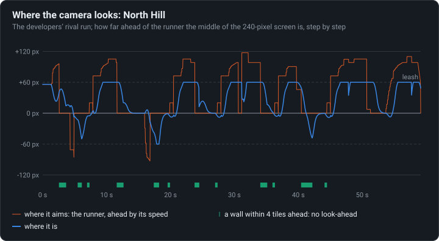

# The camera

The camera aims ahead of the runner by its speed, not when a wall is near, and a leash holds it
back: at running speed it wants 98 pixels ahead and gets 60.

<!-- findings:media view -->

[The animation as an MP4, 60 frames a second](view.mp4)
<!-- /findings -->

## What is going on

On a phone screen 240 pixels wide, a runner going right needs to see what is coming. The
original's camera does three things to show it, all visible in the animation, which is the
original's screen following the developers' own run of North Hill:

1. **It aims ahead.** The cross marks where the camera wants the middle of the screen to be:
   ahead of the runner, the further the faster it runs, up to half a screen.
2. **It does not look ahead at a wall.** When a wall faces the runner within four tiles the
   cross snaps back onto the runner (and turns green here): there is nothing to see behind a
   wall, and the runner is about to stop, climb or turn.
3. **It is on a spring and a leash.** The middle of the screen (the blue dot) does not jump to
   the cross, it eases towards it; and it may never leave the white box around the runner, a
   quarter of the screen each way.

The leash wins. At normal running speed the camera aims 98 pixels ahead, but it may only get 60
ahead, so most of the time it sits against the edge of its leash, and the look-ahead the
designers asked for is never fully reached. The strip on top shows the whole level and the
screen's place on it.

<!-- findings:media offset -->

<!-- /findings -->

Over the whole run: where the camera aims (orange) and where it is (blue), as pixels ahead of
the runner. The aim swings up to 100 pixels and more; the camera stops at 60, the leash. The
green marks under the chart are the moments a wall ahead cancelled the look-ahead.

**Try it** in [the Lab](https://gwynerva.github.io/parapet-classic/lab/#camera): follow the developers’ run of any level.

The numbers

<!-- findings:measured -->

| Measured                                           |               |
| -------------------------------------------------- | ------------- |
| Look-ahead at most, and at running speed (3400)    | 120 px, 98 px |
| The leash, and the farthest the camera got ahead   | 60 px, 60 px  |
| Of the rival’s 59 s on the move: held by the leash | 42 %          |
| No look-ahead for a wall ahead                     | 20 %          |

<!-- /findings -->

How it was measured

North Hill's rival recording is played on the real simulation, and Parapet's port of the
camera, checked against the original on its 240 × 320 screen, follows the rival step by step.
The "held by the leash" share counts the steps the runner moves with the camera's middle a full
60 pixels from it; near the bottom of a level the camera stops at the level's edge instead,
which shows as the screen's middle leaving the leash box. The animation is the stretch where
the look-ahead switches off and on the most.

Run it again with `npm run findings -- 10`. The experiment:
[`packages/lab/src/experiments/camera.ts`](../../../packages/lab/src/experiments/camera.ts); the
page:
[`packages/lab/src/findings/10-the-camera.ts`](../../../packages/lab/src/findings/10-the-camera.ts).

Under the hood: the original’s code and Parapet’s

In [`d.java`](../../decompiled/d.java), `void_a(e)` at line 9351 sets the target, `b(int, boolean)`
at line 9436 moves the camera ([`04-rendering.md`](../../notes/04-rendering.md), Camera):

- target = runner − (120 px, about 184 px), plus the look-ahead `vx · 3840 / 4143` across (at
  most 120 px) and `vy · 5120 / 4143` down;
- the look-ahead across is 0 when, in one of the four columns ahead, both the runner's row and
  the row above hold a tile facing it (a wall, a building's corner, a post);
- the spring adds `dx · 200 / 65536` to its speed each tick, its speed capped by the distance;
- the leash: within 60 px across and 80 px up or down of the runner, then the level's edges.

Parapet's [`Camera.ts`](../../../packages/runtime/src/render/Camera.ts) is this camera, tested
against the oracle's traces; on screens wider or taller than the phone's, its distances are the
same fractions of the screen, and it keeps the runner above the touch buttons.

