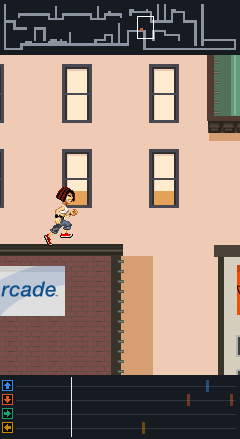
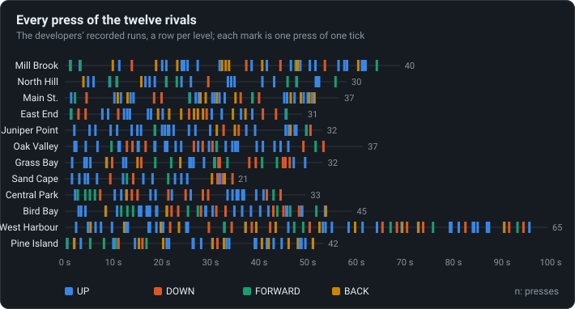
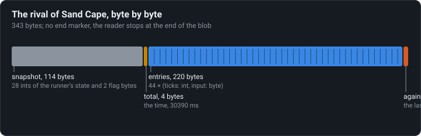

# Rivals are replays

The rivals are the developers’ own runs: presses recorded tick by tick and played back through
the player’s physics. No AI.

<!-- findings:media replay -->

[The animation as an MP4, 60 frames a second](replay.mp4)
<!-- /findings -->

## What is going on

In a Sprint you race a rival. It runs, jumps, flips and rolls like a person, because it is one:
each level ships a recording of one of the developers playing it. Not a video, and not a path
to follow, but only the keys they pressed and when. The game puts a second runner on the level
and feeds it those presses through exactly the same physics as yours. Under the screen above
is that recording, a roll of presses scrolling past a playhead: every move of the rival starts
on the tick its press comes up.

<!-- findings:media presses -->

<!-- /findings -->

All twelve recordings side by side: between 21 and 65 presses a run, often a second or more
apart. The runner does most of the work itself; a press starts a move that plays out on its
own. And every press is a single tick long: the developers' keypads did not hold keys either
(see [Keys are pressed, never held](../01-keys-are-pressed-never-held/)).

A replay only works if the physics are exactly the same every time, to the last unit: one unit
off and the rival misses a ledge, and from then on runs into walls. That makes the recordings a
free test for a remake. Parapet's rivals are checked step by step against traces of the
original's own code running them.

<!-- findings:media blob -->

<!-- /findings -->

The files are tiny: a snapshot of the runner at the start, the total time, and five bytes per
press or pause. They hold a couple of oddities: the last entry is written twice, there is no end
marker, and the recordings of Bird Bay and West Harbour sit in each other's places in the data, which
nobody noticed because the level table points at the right ones.

The numbers

<!-- findings:measured -->

| Measured                                        |                                   |
| ----------------------------------------------- | --------------------------------- |
| Recordings, one per level                       | 12                                |
| Snapshot, and an entry                          | 114 bytes, 5 bytes                |
| Presses in all, and those longer than one tick  | 445, 0                            |
| Fewest and most presses                         | 21 (Sand Cape), 65 (West Harbour) |
| Total time = 30 ms × (ticks − the last entry’s) | 12 of 12                          |
| Levels whose rival blob is out of order         | Bird Bay and West Harbour         |
| Start delays                                    | 50 to 3000 ms                     |

<!-- /findings -->

How it was measured

The twelve recordings as extracted from the jar. The total time is checked against the entries;
the replay is Sand Cape's rival in a Sprint of the real simulation, with Parapet's port of the
camera following it, and the check that its first jump falls on the tick of its first UP after
its start delay. The animation is the 150-tick stretch with the most presses.

Run it again with `npm run findings -- 11`. The experiment:
[`packages/lab/src/experiments/rivals.ts`](../../../packages/lab/src/experiments/rivals.ts); the
page:
[`packages/lab/src/findings/11-rivals-are-replays.ts`](../../../packages/lab/src/findings/11-rivals-are-replays.ts).

Under the hood: the original’s code and Parapet’s

- Written at [`d.java`](../../decompiled/d.java) lines 4782 and 4951, read at 4824 and 4919: 28
  big-endian ints of the runner's state and 2 flag bytes (114 bytes), the total time, then
  `(int ticks, byte input)` entries ([`05-modes-data.md`](../../notes/05-modes-data.md), Rivals).
- The input is the press bits: 1 UP, 2 DOWN, 4 right, 8 left, 16 forward, 32 back; an arrow is
  stored with both its direction and its meaning (forward or back) already worked out.
- `totalTime == 30 · (Σ ticks − the last entry's ticks)` for all twelve: the writer appends the
  last entry twice and the reader stops at the end of the blob.
- When a rival's presses run out the frame loop forces it into the stop state 5 (lines
  10500–10503); no rule of the move table ever leads there
  ([The parkour is a table](../04-the-parkour-is-a-table/)).
- Level 9's rival (Bird Bay; levels count from 0 in the data) is blob 14 and level 10's (West
  Harbour) blob 13 of `b0`; the mission table says so.

Parapet plays them back the same way: `InputPlayer` in
[`packages/sim/src/replay.ts`](../../../packages/sim/src/replay.ts) and the rival in
[`world.ts`](../../../packages/sim/src/world.ts). The player's own runs are recorded the same way,
which is what its replays and ghosts are.

