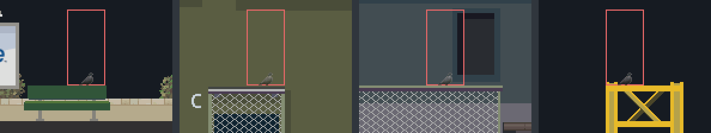
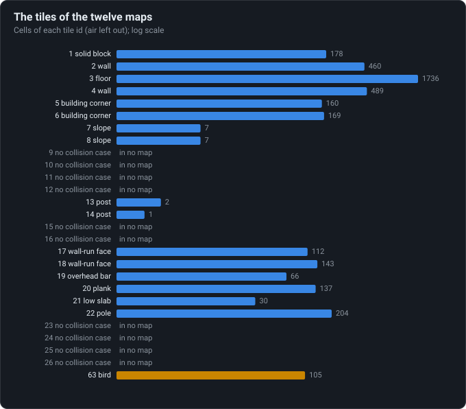

# Level map quirks

Loading a level stamps its checkpoints into the map: four birds sit where a stamp lands and
never appear. Ten tile ids the engine knows are in no map.

<!-- findings:media birds -->

<!-- /findings -->

## What is going on

Under the drawings of [Vector backgrounds](../09-vector-backgrounds/), every level is also a
grid of tiles that says what is solid: floors, walls, building corners, posts, poles. The grid
holds a few other things too, and when a level loads the game tidies it:

- The **checkpoints** of the mission are written into the grid, each as a marker in two cells,
  one above the other, over whatever was there.
- The **birds**, which sit on roofs and fences and fly off as the runner comes, are marked in
  the grid as a special tile. The game lifts them out and turns them into birds.

The order matters: the checkpoints are stamped first. Wherever a checkpoint lands on a bird's
cell, the bird's mark is gone before the game looks for birds. That happens four times in the
twelve levels. In each picture above the red frame is the stamped cells, and the faint bird is
the one that would have perched there and never does.

Nothing worse happens: the designers never put a checkpoint over anything solid. Of the 252
cells the stamps cover in all the missions, none held a wall or a floor.

<!-- findings:media tiles -->

<!-- /findings -->

The tiles the maps use, by count. Floors and walls fill thousands of cells; slopes and the low
posts to vault are rare, a handful each. And ten tile kinds that the game's code reserves an id
for (half slopes and variants, by the look of them) have no collision code and are in no map:
planned, perhaps, and never built.

One more tidy-up checked here: each column of the grid gets a "pit" depth from its lowest floor,
below which the runner counts as fallen. A column without any floor gets depth zero, which would
make any height in it a pit. It happens only in the outermost columns of six levels, behind
their end walls, where no runner ever goes.

The numbers

<!-- findings:measured -->

| Measured                                                                         |                                                                                                                                                                        |
| -------------------------------------------------------------------------------- | ---------------------------------------------------------------------------------------------------------------------------------------------------------------------- |
| Birds in the maps                                                                | 105                                                                                                                                                                    |
| Birds a checkpoint stamp erases                                                  | East End, Sprint, checkpoint 1 (26, 9); Bird Bay, Sprint, checkpoint 3 (95, 9); Bird Bay, Flag hunt, checkpoint 5 (15, 11); West Harbour, Sprint, checkpoint 1 (13, 3) |
| Stamped cells, and those that held a collision tile                              | 252, 0                                                                                                                                                                 |
| Levels with columns without a floor (pit row 0); of those columns inside the map | 6; 0: each is a map’s first or last column                                                                                                                             |
| Tile ids without a collision case, used in no map                                | 9, 10, 11, 12, 15, 16, 23, 24, 25, 26                                                                                                                                  |

<!-- /findings -->

How it was measured

The twelve tile maps as extracted, and every mission's checkpoints: the cells the stamps cover
and what they held; the pit depth of every column as Parapet's level loader computes it; the
count of every tile id. The pictures crop each level's art around the bird's cell.

Run it again with `npm run findings -- 12`. The experiment:
[`packages/lab/src/experiments/levelMaps.ts`](../../../packages/lab/src/experiments/levelMaps.ts);
the page:
[`packages/lab/src/findings/12-level-map-quirks.ts`](../../../packages/lab/src/findings/12-level-map-quirks.ts).

Under the hood: the original’s code and Parapet’s

- [`d.java`](../../decompiled/d.java) lines 9630–9637: checkpoint `i` is written as tile `49 + i`
  into `(x, y)` and `(x, y − 1)`; then the pit rows (`killRow[x]`, the deepest row holding a
  tile of {1, 3, 5, 6, 7, 8}, or 0), then the birds, tile 63, become particles and their cells
  air ([`01-formats.md`](../../notes/01-formats.md), Tile catalogue).
- The pit check: a runner whose hands are more than two tiles below its column's pit row has
  fallen.
- Tile ids 9–12, 15, 16 and 23–26 have no case in the collision shapes (lines 8731–8972).

Parapet loads levels the same way, in the same order
([`packages/sim/src/level/level.ts`](../../../packages/sim/src/level/level.ts)), so the four
birds are missing there too.

