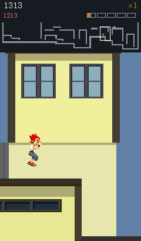
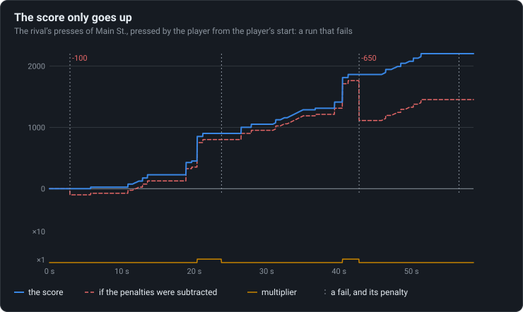

# The score never drops

A fail works out a penalty and never applies it: the score only goes up. A fail costs the trick
in progress and part of the multiplier.

<!-- findings:media fail -->

[The animation as an MP4, 60 frames a second](fail.mp4)
<!-- /findings -->

## What is going on

Tricks score points, times a multiplier that grows as you keep going without a mistake. When
the runner stumbles or crashes, the original adds up a penalty: the points of the combo in
progress, times the multiplier. In the animation it floats up next to the score in red... and
the score does not change. The game works the penalty out and then never subtracts it.

What a fail really costs is quieter: the trick in progress earns nothing, and the meter that
drives the multiplier drops, so the next tricks are worth less for a while.

<!-- findings:media score -->

<!-- /findings -->

The chart is a whole run with four fails. The score (blue) only ever climbs. The dashed red line
is what it would have been if each penalty had been taken off; under the chart, the multiplier
dropping at every fail.

Where does a run like that come from? It is a level's rival recording (see
[Rivals are replays](../11-rivals-are-replays/)) pressed by the player instead, from the
player's starting point, a tile away from the rival's. The same presses a tile off are a
different run: it goes off the developers' script and fails here and there, which is just what
was needed.

The numbers

The meter runs from 0 to 5120; each 1024 of it raises the multiplier (1, 2, 4, 6, 8, 10).

<!-- findings:measured -->

| Measured                                       |                                    |
| ---------------------------------------------- | ---------------------------------- |
| Fails of the run, and their penalties          | 4: -100, 0, -650, 0                |
| Final score, and with the penalties subtracted | 2203, 1453                         |
| Steps on which the score went down             | none                               |
| The meter before and after each fail (of 5120) | 0 → 0, 1250 → 0, 1100 → 0, 400 → 0 |

<!-- /findings -->

How it was measured

A Score run of Main St. on the real simulation, with the level's rival presses as the player's
input from tick 0. After every tick the score, the meter and the multiplier are kept, and on
every fail the penalty the game computed. The animation is the stretch around the largest
penalty, on the original's screen with Parapet's port of the camera.

Run it again with `npm run findings -- 13`. The experiment:
[`packages/lab/src/experiments/score.ts`](../../../packages/lab/src/experiments/score.ts); the
page:
[`packages/lab/src/findings/13-the-score-never-drops.ts`](../../../packages/lab/src/findings/13-the-score-never-drops.ts).

Under the hood: the original’s code and Parapet’s

- `aF`, [`d.java`](../../decompiled/d.java) line 7480, on entering a fail state: `g` (the
  penalty) becomes minus the sum of the combo's points times the multiplier, the combo and its
  pending points are cleared, and `av()` drops the meter by 2048 (not below 0). Nothing ever
  reads `g`.
- `aG`, line 7496, every tick: points go to the score times the multiplier, and to the meter
  ([`03-physics.md`](../../notes/03-physics.md), Scoring).

Parapet keeps the rule: `ScoreState.fail` in
[`packages/sim/src/scoring.ts`](../../../packages/sim/src/scoring.ts) computes `penalty` and
leaves the score alone, so records are comparable with the original's. Its HUD shows the
meter's drop as the original did, a shake of the multiplier.

