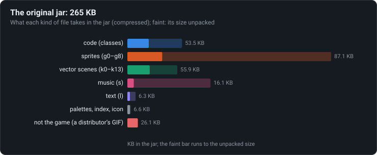
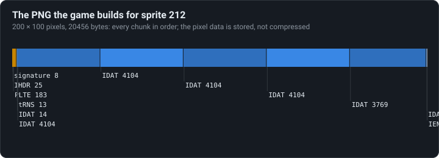
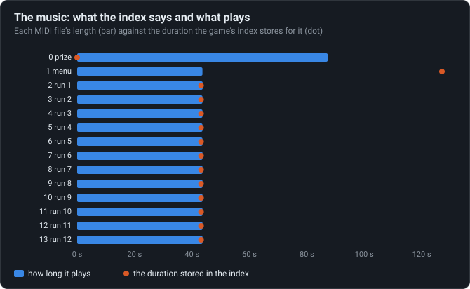

# What’s in the jar

The sprites ship as raw pixels and become PNGs in memory, built byte by byte; the stored music
lengths are mostly wrong; a tenth of the jar is not the game.

<!-- findings:media jar -->

<!-- /findings -->

## What is going on

The whole game is one Java archive of 265 KB: a phone of 2007 had to download it over a slow,
expensive connection. The chart is what fills it. The sprites take a third, the code a fifth,
the drawings of the runner and the levels (see [One vector runner](../08-one-vector-runner/) and
[Vector backgrounds](../09-vector-backgrounds/)) about as much again, then the music and the
text. And a tenth of the jar is a picture that is not part of the game at all: a GIF added by a
distributor, which the game never opens.

**Pictures made on the fly.** The sprites are not stored as image files. Each is just its size,
a palette number and its pixels, one byte each, which the archive's own compression packs well.
When the game needs a sprite it writes a complete PNG file into memory, byte by byte, and hands
it to the phone to decode: the phone already knows PNG, so the game needs no image code of its
own. Those PNGs are not even compressed; the data goes in "stored" blocks, each in a chunk of
its own. Rebuilt the original's way here, all 314 of them decode back to exactly the right
pixels.

<!-- findings:media png -->

<!-- /findings -->

**Music with the wrong length.** The music is fourteen MIDI files glued into one. The game's
index stores a duration for each, and they are mostly not what the files play: the prize
music says 0 and plays for 87 seconds, the menu music says 127 seconds and plays 44, and all
twelve in-game tracks say the same 43.157 seconds. The in-game tracks are indeed all about that
long, but never exactly. There are no sound effects at all: the game shakes the phone instead.

<!-- findings:media music -->

<!-- /findings -->

The numbers

<!-- findings:measured -->

| Measured                                                     |                               |
| ------------------------------------------------------------ | ----------------------------- |
| The jar, and its files                                       | 265.2 KB, 41                  |
| Of it the code                                               | 53.5 KB                       |
| A distributor’s GIF the game never reads                     | 26.1 KB (10 %)                |
| Sprites, of them 32-bit                                      | 314, 42                       |
| PNGs built the original’s way that decode to the same pixels | 314 of 314                    |
| Their bytes, against the raw pixels                          | 573.0 KB, 507.1 KB            |
| Most IDAT chunks in one of them                              | 7                             |
| Prize track: stored, plays                                   | 0 ms, 87.3 s                  |
| Menu track: stored, plays                                    | 127067 ms, 43.6 s             |
| The twelve run tracks: stored, play                          | 12 × 43157 ms; 43.6 to 43.7 s |
| Volume changes in the menu track                             | 1516                          |

<!-- /findings -->

How it was measured

Read in Node from the jar itself (`packages/content/playman/original`): the sizes of its files
from the archive's directory; the sprites from the packs `g0`–`g8` and the palettes from `p`;
each sprite's PNG rebuilt by a port of the game's builder and decoded with a separate PNG
decoder, compared pixel for pixel with the sprite. The music lengths come from reading each MIDI
file to its last event with its tempo changes; the stored durations from the game's index.

Run it again with `npm run findings -- 14`. The page lives with the tools, since it reads files:
[`packages/tools/src/findings/jar.ts`](../../../packages/tools/src/findings/jar.ts), the PNG
builder [`originalPng.ts`](../../../packages/tools/src/findings/originalPng.ts), the MIDI
reader [`midi.ts`](../../../packages/tools/src/findings/midi.ts).

Under the hood: the original’s code and Parapet’s

- `int_a`, [`d.java`](../../decompiled/d.java) line 430, builds the PNG: signature; IHDR, 8 bits,
  colour type 3 (palette) or 6 (32-bit sprites); PLTE of `n + 1` entries, the first and the last
  filler; a one-byte tRNS that makes index 0 transparent; then a zlib stream that compresses
  nothing: its header `78 DA` in one IDAT, each stored block (at most 4087 bytes, or 1015 pixels
  of a 32-bit sprite) in its own IDAT, the Adler-32 in another, and IEND. The CRC table is built
  by `void_b`, line 372 ([`01-formats.md`](../../notes/01-formats.md)).
- The music is the resource `s`; offsets, lengths and durations are in the index `i`
  ([`01-formats.md`](../../notes/01-formats.md)).
- The GIF is `MC_KoMpOtIk.gif`; no line of the code names it.

Parapet does not build PNGs at run time: `npm run extract` decodes the jar once into ordinary
files and an atlas ([`packages/tools/src/extract.ts`](../../../packages/tools/src/extract.ts)),
and its music player measures each track itself.

