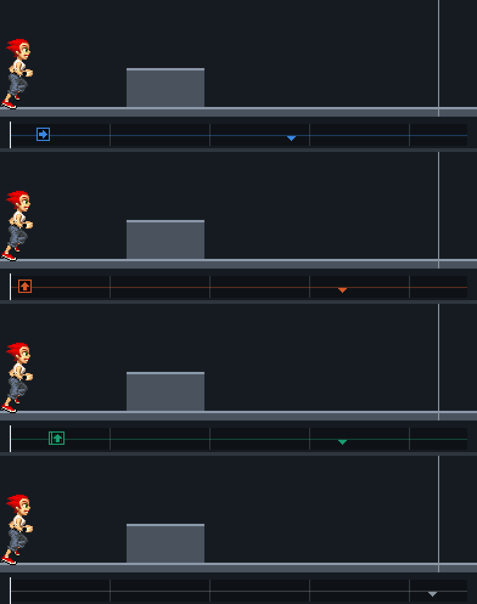
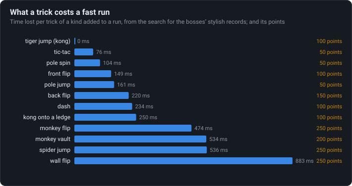

# What tricks cost

The game pays for speed, not style: the quick tricks are in every fast run, and the showy ones
cost a quarter of a second to almost a second each.

<!-- findings:media race -->

[The animation as an MP4, 60 frames a second](race.mp4)
<!-- /findings -->

## What is going on

Parapet's bosses race records found by a computer search over the game's own simulation: the
fastest runs a human could play (no press that only works on one exact tick), and the most
stylish runs within 5 % and 15 % of them. Comparing the stylish runs with the fastest ones tells
what each kind of trick costs in time.

<!-- findings:media cost -->

<!-- /findings -->

The tiger jump, a vault with both hands over an obstacle, costs nothing: it is the quickest way
over most obstacles and every one of the fastest runs is full of them. Tic-tacs off a wall and
the pole tricks are almost free too. The showy tricks cost a quarter of a second to almost a
second each: the monkey vault, the spider jump, and most of all the wall flip. In a race they
earn nothing; only the Score mode pays for them.

The animation shows the same thing on one low block of the Moves menu, where anyone can try it.
Taken four ways, each as early as it gets over cleanly: a tiger jump is first; a jump and a jump
with a monkey vault arrive together, 0.58 s later; and pressing nothing at all, letting the
runner step over the block by itself, is the slowest. The vault's 0.58 s is close to what the
search found it costs in whole runs.

The numbers

<!-- findings:measured -->

| Measured                                                                |                                                                        |
| ----------------------------------------------------------------------- | ---------------------------------------------------------------------- |
| Kinds of trick measured; the cheapest and the dearest                   | 12; tiger jump (kong), wall flip                                       |
| One block, four ways, fastest first (time behind the first)             | tiger jump +0.00 s; jump +0.58 s; monkey vault +0.58 s; no key +1.60 s |
| The vault behind the tiger jump on it, and a vault’s cost in the search | 580 ms, 534 ms                                                         |

<!-- /findings -->

How it was measured

The cost table is read from the search's write-up,
[`reference/notes/09-tas.md`](../../notes/09-tas.md) (section Style), which explains how it was
worked out: a stylish run's loss shared among the kinds of trick it added, by the points each
brought. The bosses' routes themselves are kept out of the repository and out of this page.

The race: the Moves menu's monkey vault level; for each way (FORWARD for the tiger jump, UP for
the jump, UP then UP for the vault, no key) every press step from 95 to 135, and for the vault
every second press up to 23 steps later, is tried on the real simulation; the earliest clean
run, without a stumble or a crash, that does the move is the one shown, timed to a line past
the block.

Run it again with `npm run findings -- 15`. The page:
[`packages/tools/src/findings/tricks.ts`](../../../packages/tools/src/findings/tricks.ts); the
race: [`packages/lab/src/experiments/race.ts`](../../../packages/lab/src/experiments/race.ts).

Under the hood: the original’s code and Parapet’s

- The points of each trick are the move table's (`[13]` of each state,
  [`02-moves.md`](../../notes/02-moves.md)); a timed mission ignores them.
- The tiger jump: FORWARD while running faster than 1750 enters state 56; the monkey vault: UP
  waiting on landing on an obstacle enters 62
  ([Keys are pressed, never held](../01-keys-are-pressed-never-held/)).
- Without a key the runner steps over a low obstacle by itself (states 42, 45, 46), slowly.

In Parapet the search is `npm run tas`
([`packages/tools/src/tas`](../../../packages/tools/src/tas)), the style score
[`style.ts`](../../../packages/tools/src/tas/style.ts).

