# The original, taken apart

**Playman Extreme Running** was a parkour game for mobile phones, released in 2007 by Mr.Goodliving
for Java phones: a runner, twelve city levels, rooftops, walls and poles, played with four keys
on a phone keypad. While building [Parapet Classic](../../README.md), a remake that plays exactly
like the original, we read its code and data closely enough to rebuild them. Along the way the
original turned out to be full of small clever ideas, a few accidents, and some things nobody
was ever meant to notice.

These pages tell fifteen of them. Each one is a short story with pictures you can watch, then,
folded away for those who want them, the measured numbers, how they were measured, and the
lines of the original's code and of ours.

Seven of them can be played with in the browser, in [the Lab](https://gwynerva.github.io/parapet-classic/lab/).

<!-- findings:index -->

### I. The controls

<table>
<tr>
<td width="50%" valign="top">
<a href="01-keys-are-pressed-never-held/">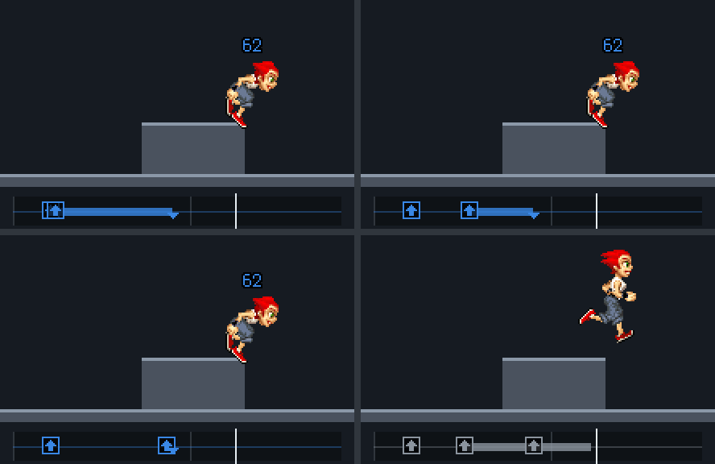</a> 
<b><a href="01-keys-are-pressed-never-held/">1. Keys are pressed, never held</a></b> 
A press waits in a buffer until the runner can use it: a vault pressed anywhere in the jump starts on the same step, and one more key on that step loses it.
</td>
<td width="50%" valign="top">
<a href="02-armed-not-timed/">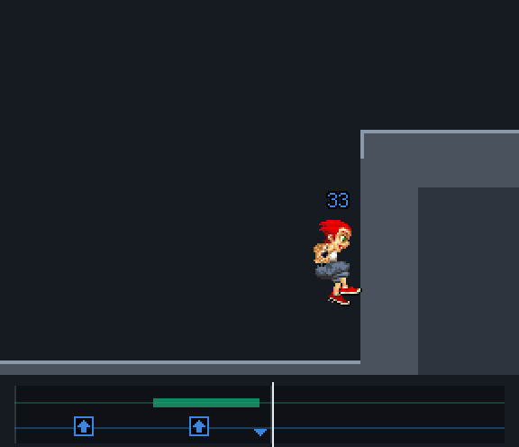</a> 
<b><a href="02-armed-not-timed/">2. Armed, not timed</a></b> 
In the air the runner looks ahead: UP pressed while it sees a wall arms the wall run, which starts on contact, the same step for every press.
</td>
</tr>
<tr>
<td width="50%" valign="top">
<a href="03-one-press-two-kicks/">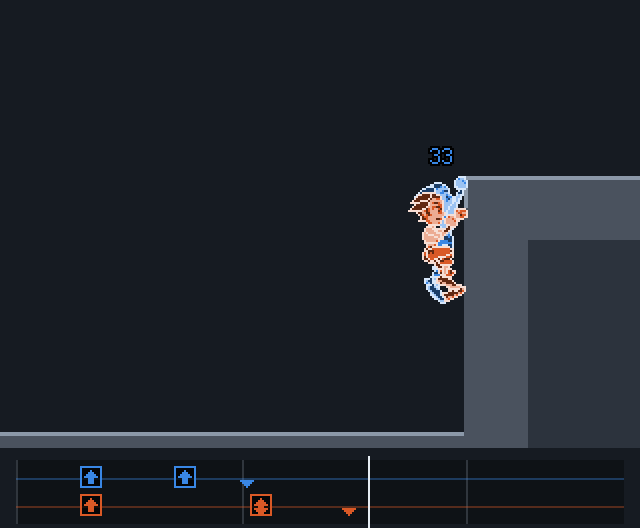</a> 
<b><a href="03-one-press-two-kicks/">3. One press, two kicks</a></b> 
Pressed on contact, one UP kicks off the wall twice and climbs; pressed a moment earlier, once, and falls.
</td>
</tr>
</table>

### II. The engine

<table>
<tr>
<td width="50%" valign="top">
<a href="04-the-parkour-is-a-table/">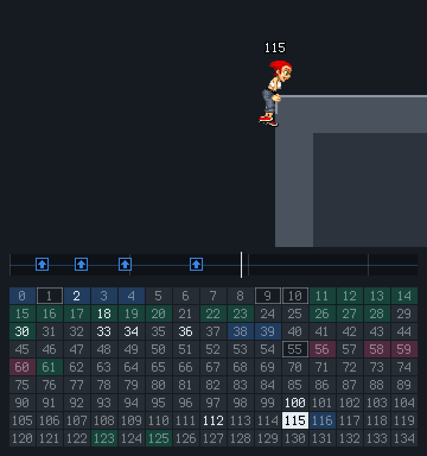</a> 
<b><a href="04-the-parkour-is-a-table/">4. The parkour is a table</a></b> 
Every move is a few rows of one table of 135 states; the code only runs it. Read whole, the table has instant states, a state only the code enters and transitions that never fire.
</td>
<td width="50%" valign="top">
<a href="05-landing-keeps-horizontal-speed/">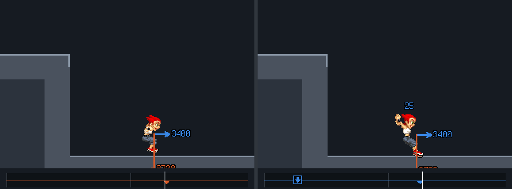</a> 
<b><a href="05-landing-keeps-horizontal-speed/">5. Landing keeps the horizontal speed</a></b> 
At touchdown the fall’s speed is thrown away and the horizontal speed kept; how hard the landing is depends on the vertical speed alone.
</td>
</tr>
<tr>
<td width="50%" valign="top">
<a href="06-fixed-point-maths/">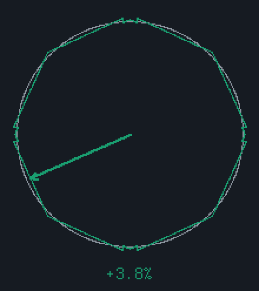</a> 
<b><a href="06-fixed-point-maths/">6. Fixed-point maths</a></b> 
No floating point anywhere: lengths come from a 16-sided “circle” with steps in it, the sine table is grown from one number, square roots are exact integers.
</td>
<td width="50%" valign="top">
<a href="07-slow-phones-slow-down/">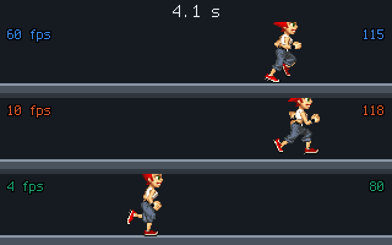</a> 
<b><a href="07-slow-phones-slow-down/">7. Slow phones slow down</a></b> 
Game time per frame is capped, so a slow phone plays in slow motion rather than skipping; and it is cut to whole units, so every screen runs a little slow, a fast one more.
</td>
</tr>
</table>

### III. The picture

<table>
<tr>
<td width="50%" valign="top">
<a href="08-one-vector-runner/">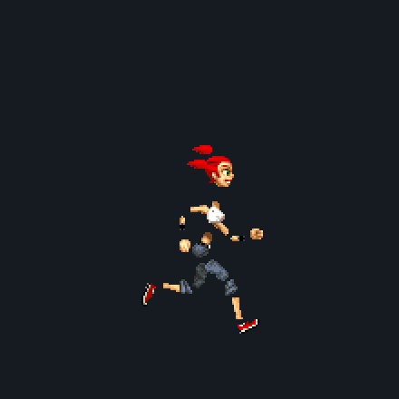</a> 
<b><a href="08-one-vector-runner/">8. One vector runner</a></b> 
The runner is no sprite sheet: 19 layers of small sprites placed anew in each of 463 keyframes and tweened between them; a character is a swap of a few sprites.
</td>
<td width="50%" valign="top">
<a href="09-vector-backgrounds/">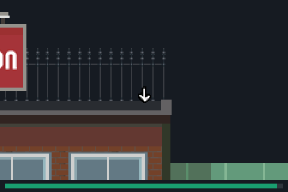</a> 
<b><a href="09-vector-backgrounds/">9. Vector backgrounds</a></b> 
The levels are not pictures: each is one object of coloured rectangles, sprites and shared props, drawn anew every frame, and the warm-up’s arrows pulse by tweening it.
</td>
</tr>
<tr>
<td width="50%" valign="top">
<a href="10-the-camera/">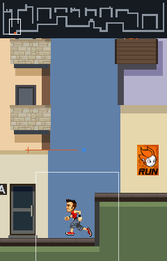</a> 
<b><a href="10-the-camera/">10. The camera</a></b> 
The camera aims ahead of the runner by its speed, not when a wall is near, and a leash holds it back: at running speed it wants 98 pixels ahead and gets 60.
</td>
</tr>
</table>

### IV. The data

<table>
<tr>
<td width="50%" valign="top">
<a href="11-rivals-are-replays/">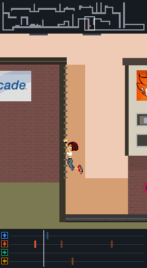</a> 
<b><a href="11-rivals-are-replays/">11. Rivals are replays</a></b> 
The rivals are the developers’ own runs: presses recorded tick by tick and played back through the player’s physics. No AI.
</td>
<td width="50%" valign="top">
 
<b><a href="12-level-map-quirks/">12. Level map quirks</a></b> 
Loading a level stamps its checkpoints into the map: four birds sit where a stamp lands and never appear. Ten tile ids the engine knows are in no map.
</td>
</tr>
<tr>
<td width="50%" valign="top">
<a href="13-the-score-never-drops/">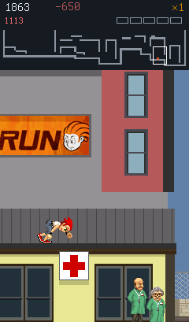</a> 
<b><a href="13-the-score-never-drops/">13. The score never drops</a></b> 
A fail works out a penalty and never applies it: the score only goes up. A fail costs the trick in progress and part of the multiplier.
</td>
<td width="50%" valign="top">
 
<b><a href="14-whats-in-the-jar/">14. What’s in the jar</a></b> 
The sprites ship as raw pixels and become PNGs in memory, built byte by byte; the stored music lengths are mostly wrong; a tenth of the jar is not the game.
</td>
</tr>
</table>

### V. The search

<table>
<tr>
<td width="50%" valign="top">
<a href="15-what-tricks-cost/">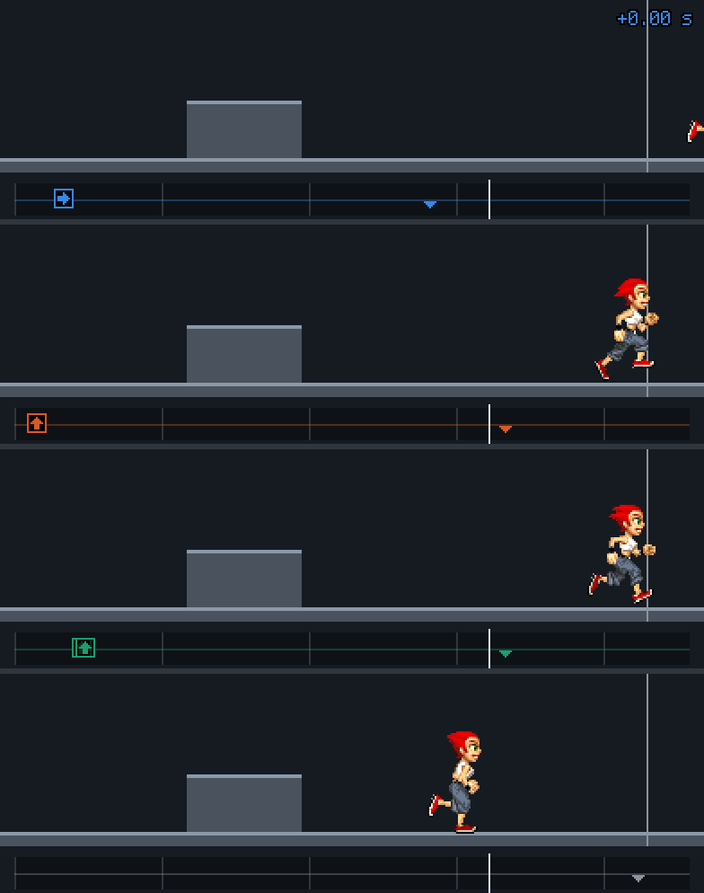</a> 
<b><a href="15-what-tricks-cost/">15. What tricks cost</a></b> 
The game pays for speed, not style: the quick tricks are in every fast run, and the showy ones cost a quarter of a second to almost a second each.
</td>
</tr>
</table>
<!-- /findings -->

## How these pages were made

Nothing here is drawn by hand. Every number is measured, and every picture drawn, by running
Parapet's simulation, which reproduces the original step for step, on the original's own data:
its move table, its levels, its sprites, its developers' recorded runs. "What if" comparisons
change the game's data, never its code. A test checks that each page still shows what it says,
and `npm run findings` measures everything again and redraws the pictures (see
[`packages/lab`](../../packages/lab) and
[`packages/tools/src/findings`](../../packages/tools/src/findings)).

A few words that come up:

- **a step** (or tick): the game moves on in steps of 30 units of game time, about 34 ms, 29
  times a second;
- **a tile**: the levels are grids of tiles, 32 pixels on the phone's screen;
- **a state**: the runner is always in one of 135 states (running, jumping, the first kick of a
  wall run...), and the moves are the ways from one to the next.

The animations are GIFs, each with an MP4 at twice the size and 60 frames a second next to it.

The original's code is quoted from a decompilation (`reference/decompiled/d.java`, CFR 0.152),
explained further in [`reference/notes`](../notes). The pictures contain the original's art.
Playman Extreme Running and its art belong to their rights holders; this is a non-commercial
study, not affiliated with or endorsed by them.
